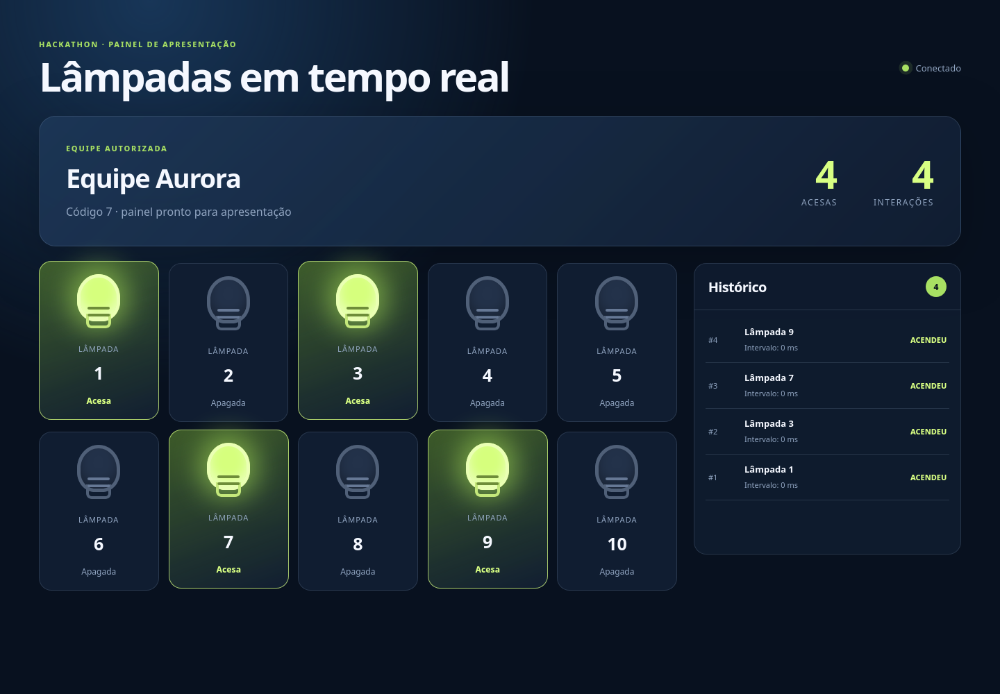
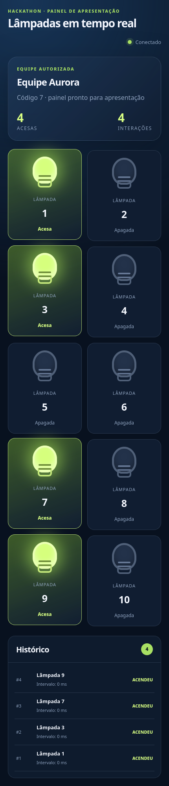

# Lâmpadas — painel de desafios de Hackathon

Este repositório contém o painel usado em campeonatos de Hackathon. As equipes recebem desafios de lógica e enviam sequências de estados para as lâmpadas; o painel apresenta o resultado em tempo real para o público.

## O que mudou

A base antiga era uma aplicação ASP.NET MVC/.NET Framework com SignalR, assets de terceiros commitados em grande volume e clientes de exemplo com URLs fixas, configuração frágil e loops infinitos. A estrutura atual foi simplificada para:

- **Servidor Node.js sem dependências de runtime**, com painel estático, API HTTP e eventos SSE.
- **Estado de rodada explícito**, com validação de equipes, autorização única e desligamento automático ao trocar a equipe autorizada.
- **Cliente TypeScript configurável por ambiente**, com tarefas determinísticas, execução única por padrão e testes de lógica.
- **Exemplos .NET, Java e Python** com configuração por variáveis de ambiente, timeout e encerramento previsível.
- **Documentação de execução e API**, além de testes automatizados para os contratos principais.

Assets de terceiros e arquivos gerados da antiga aplicação foram removidos; a interface atual não depende de CDN, jQuery, Bootstrap ou fontes externas para funcionar.

## Execução rápida

Requer Node.js 20 ou superior.

```bash
cd Servidor
npm start
```

Abra `http://localhost:3000`. O painel inicia com 10 lâmpadas apagadas e a equipe padrão `squad37`, código `0`.

## Interface

A interface foi desenhada para apresentação em tela grande, mas também se adapta a dispositivos móveis. As capturas abaixo foram feitas executando o painel localmente com uma rodada demonstrativa, equipe autorizada e lâmpadas em estados diferentes.

### Visão desktop



### Visão mobile



Para simular uma equipe:

```bash
curl -X POST http://localhost:3000/api/equipe \
  -H 'content-type: application/json' \
  -d '{"codEquipe":7,"nome":"Equipe 7"}'

curl -X PUT http://localhost:3000/api/equipe/7 \
  -H 'content-type: application/json' \
  -d '{"autorizada":true}'

curl -X PUT http://localhost:3000/api/lampada/1/status \
  -H 'content-type: application/json' \
  -d '{"idEquipe":7,"status":true}'
```

## Estrutura

```text
Servidor/                 API, painel e testes de integração
Solucao/Nodejs/           cliente TypeScript para os desafios
Exemplos/                 clientes didáticos em Python, Java e .NET
```

## Validação local

```bash
cd Servidor
npm run check
npm test

cd ../Solucao/Nodejs
npm ci
npm test
npm run build
```

Não é necessário instalar dependências para executar o servidor. Os comandos `npm ci` e `npm test` da solução TypeScript instalam somente as dependências de desenvolvimento do cliente.

## Configuração do cliente TypeScript

```bash
cd Solucao/Nodejs
cp .env.example .env
# edite LAMPADAS_API_URL e COD_EQUIPE
npm run once -- --task 1
```

O cliente também aceita `--task all` para uma rodada com todos os desafios, `--repeat` para repetir até `Ctrl+C` e `--dry-run` para visualizar a sequência sem chamar a API.

## Contrato da API

A referência operacional está em [`Servidor/README.md`](Servidor/README.md). O endpoint de atualização continua compatível com os clientes históricos:

```http
PUT /api/lampada/{idLampada}/status
Content-Type: application/json

{ "idEquipe": 7, "status": true }
```

## Observações de operação

O servidor mantém o estado **em memória**, por decisão de produto: cada campeonato representa uma rodada efêmera e reiniciar o processo deve limpar o painel. Para uso em rede, defina `CORS_ORIGIN` explicitamente em vez de manter `*`.
